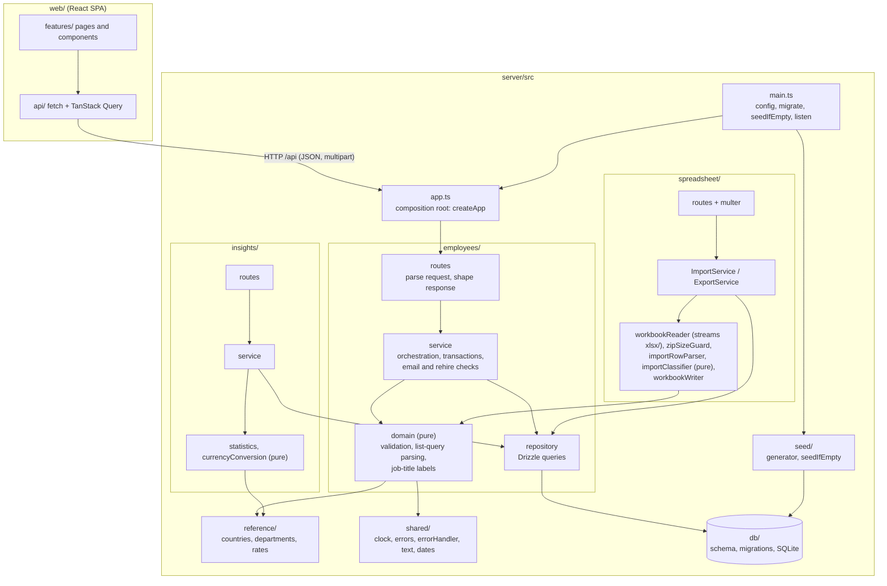

# Architecture

How ACME Salary Management is built, why, and what would change for production. Read with the [spec](specs/salary-management-spec.md) (what "done" means) and the [plan](plans/salary-management-plan.md) (slice-by-slice design). Everything here describes the code as built.

## Overview

One TypeScript monorepo (npm workspaces), deployed as **one container**: an Express 5 API that also serves the built React app.

| Workspace | Role |
|---|---|
| `contracts/` | Types only (`EmployeeSummary`, `ImportPreview`, `ApiErrorBody`, ...). Imported by server and web, so the API shape is checked at compile time on both sides. No build step. |
| `server/` | Express 5 + SQLite (better-sqlite3) + Drizzle ORM. Run with `tsx`; `tsc` only type-checks. |
| `web/` | React 19 SPA: Vite, Tailwind, shadcn/ui (Radix), TanStack Query, React Router 7, react-hook-form. |

In production `web/dist` is served by Express (`serveWebApp` in `server/src/app.ts`): static files first, then `index.html` for any `GET` outside `/api` that accepts HTML. Unknown `/api/*` routes always return a JSON 404, never HTML.

## Modules and layers

The server is a modular monolith. Each feature module has the same layers, and every dependency points inward or toward `reference/` and `shared/`.



Rules that hold across the code:

- **One-way modules:** `reference` and `shared` depend on nothing; `employees` depends on them; `insights` and `spreadsheet` depend on `employees`, `reference`, `shared`. Nothing depends on `seed` except `main.ts`.
- **Pure domain code:** validation, statistics, row parsing and import classification are pure functions of their inputs (today's date comes in as an argument). That is what makes the unit tests fast and deterministic.
- **No repository interfaces:** one implementation each (YAGNI). Tests use a real in-memory SQLite database rather than mocks.
- **Composition root:** `createApp({ db, clock, webDistPath? })` builds repositories, services and routers. Tests build the same app with a fixed clock.
- **One error vocabulary:** domain errors in `shared/errors.ts`; one `errorHandler` maps them to `{ error: { code, message, fieldErrors?, preview? } }`. Unknown errors become a generic 500 and are logged.

## Import: preview then confirm

The import is **stateless**: the server stores nothing between the two steps. The browser keeps the selected file, and **Confirm** uploads it again.

```mermaid
sequenceDiagram
    actor HR as HR manager
    participant UI as web ImportPanel
    participant API as POST /api/imports/preview
    participant APPLY as POST /api/imports
    participant P as Pipeline (read, parse, classify)
    participant DB as SQLite

    HR->>UI: choose .xlsx file
    UI->>API: multipart upload (multer, 10 MB cap)
    API->>P: readImportFile (name, size, zip guard: entry count and unzipped size, then the first sheet streamed row by row under the XML limits: header, row cap)
    P->>P: parseImportRow per row, classifyImportRows
    P->>DB: listStoredEmployees (one read query), then buildImportSnapshot
    API-->>UI: ImportPreview (totals, errors, updates, creates)
    Note over API,DB: Nothing is written

    alt preview has errors
        UI-->>HR: Confirm disabled; fix the file and preview again
    else no errors
        HR->>UI: Confirm import
        UI->>APPLY: same file, uploaded again
        APPLY->>P: same read and parse (outside the transaction)
        APPLY->>DB: BEGIN
        APPLY->>P: listStoredEmployees, buildImportSnapshot and classify again (same code as preview)
        alt any row now has an error (data changed since preview)
            APPLY->>DB: ROLLBACK (nothing written)
            APPLY-->>UI: 422 IMPORT_REJECTED with fresh preview
        else all rows valid
            APPLY->>DB: insert creates, update changed fields, add salary entries "Excel import"
            alt any write fails
                APPLY->>DB: ROLLBACK
                APPLY-->>UI: 500 IMPORT_NOT_APPLIED (database unchanged)
            else
                APPLY->>DB: COMMIT
                APPLY-->>UI: 200 { created, updated, unchanged }
            end
        end
    end
```

Rows are matched to existing employees by email. A row identical to any stored record with that email (active or inactive) is **unchanged**, so exports re-import cleanly even when a person left and came back. Otherwise a row becomes **create** (new email, or a rehire of an inactive record), **update** (a field or salary of the active employee differs), or **error** (per-row messages naming the column). The classifier never emits an update for an inactive record, and the rehire hire-date rule applies to updates as well as creates.

## Key decisions and trade-offs

| Decision | Why | Trade-off accepted |
|---|---|---|
| **SQLite + Drizzle** (better-sqlite3, drizzle-orm 0.45, generated SQL migrations committed) | One HR user and 10,000 rows. Synchronous transactions make the all-or-nothing import simple and reliable; `:memory:` databases make tests fast and isolated. Drizzle gives typed schema and queries without hiding SQL. The 1.0 line of Drizzle is still a release candidate, so the stable 0.45 is pinned. | One writer at a time, one file on one disk, no horizontal scaling. Fine here; see production notes. |
| **Validation only on the server** | One source for every rule (DRY). The web sends what was typed and shows `fieldErrors` from the 400 response next to each field. Import rows reuse the same rule functions as the forms. | A rule violation costs a round trip; no instant client-side hints. |
| **Current salary is a database view** (`current_salaries`: latest `effective_date`, ties to the highest id) | The "which salary is current" rule lives in one place, used by the list, insights, export and import. History queries order by the same constant. | A window function in a custom migration; the view is declared `.existing()` in Drizzle. |
| **Salary history is append-only; delete is soft** | The brief says changes must stay visible and deleting must never lose data. Deleting sets `status = inactive` plus an exit date. | Inactive rows stay in the table (indexed by status). |
| **Rehire instead of restore** | Re-adding a former employee creates a new record linked by email, so the earlier employment and its history stay intact. A partial unique index (`email WHERE status = 'active'`) enforces one active record per email in the database itself; the service checks first for a friendly `EMAIL_TAKEN`. | Two records for one person; the UI shows linked employments. |
| **Stateless re-upload import** | No server-side session, temp storage or expiring tokens. Confirm re-validates the file against the data as it is now, so a stale preview can never be applied blindly. | The file is uploaded and parsed twice (about 1 s each at 10,000 rows). |
| **All-or-nothing transaction** | An import that half-applies is worse than one that fails. A single `db.transaction`; any error row or failed write rolls everything back. The rollback test uses a real SQLite trigger, not a mock. | A whole file is rejected for a single bad row. HR fixes the row and retries. |
| **Zip guard** (`zipSizeGuard.ts`) | An `.xlsx` is a zip. Upload is capped at 10 MB, but a small file can inflate enormously, and a zip of many tiny entries is costly before anything is inflated (jszip builds an object per entry: 90,000 empty entries in 7.8 MB took 5.8 s and 350 MB). First the raw bytes are scanned for central-directory signatures: jszip loads one entry per signature whatever the end record declares, so more than 1,000 rejects the file before the directory is read. Then the directory is read once, and each entry is streamed with a byte counter; over 24 MB uncompressed is rejected. Declared sizes cannot be trusted (jszip reads them as signed 32-bit), hence the streamed count. The loaded archive is handed to the sheet reader, so the zip is opened once. The 24 MB limit is about 2.5 times a full 20,000-row file (a seeded export unzips to 8.4 MB; the review measured 9.4 MB for a template file); 1,000 entries is far beyond the few dozen parts Excel writes. | About 50 ms extra per upload; relies on jszip internals for the fast declared-size sum. A legitimate file with more than 1,000 parts (or a stored, uncompressed embedded zip whose own signatures push the count past 1,000) is rejected. |
| **Streamed sheet reading, no workbook model** (`spreadsheet/xlsx/`) | exceljs's full loader builds an object per cell for every sheet before anything can be checked, at roughly 40 bytes of memory per byte of sheet XML. A 9.9 MB upload with 380,000 rows peaked at 1.43 GB RSS and took 10.6 s before the row cap ran. A 6.5 KB file with one `<mergeCell ref="J2:Z100000"/>` reached 864 MB, because merges are expanded cell by cell. Even a legitimate 20,000-row file cost 352 MB, so one request could kill the 512 MB Render instance. The reader now opens the zip with jszip (the same view the guard checked) and parses only the workbook, its relationships, the styles, the shared strings and the first sheet, with saxes (the XML parser exceljs uses). The sheet is streamed row by row, and reading stops at the 20,001st data row. Streaming alone did not bound memory: the re-review crashed Node (fatal heap OOM at 1.7-2.2 GB) with a 25 KB upload of 8 million nested tags, because saxes keeps every open element on a stack, and inflated 23.5 MB of `<si><r/></si>` to 743 MB. So every part is also parsed under limits, each a 400 INVALID_FILE when passed: 64 levels of nesting, 64 attributes per element, 250,000 shared strings (a full import holds at most 180,009 distinct strings), 16,384 columns a row (reference-less cells included), 1,000 sheets and 1,000 relationships (each points at a part, and a file may have 1,000), 65,490 cell formats and number formats (Excel's own limit). Within these limits and the 24 MB one, the worst file measured (250,000 empty rich-text shared strings) peaks at 273 MB RSS in 0.54 s with a 256 MB heap, and a single 23.5 MB cell is accepted at 260 MB; a legitimate 20,000-row file takes 0.64 s and 137 MB. Memory is bounded by those limits, not by streaming. Rows must come in increasing order; a row without `r` is the one after the previous row, as OOXML allows. Cell values follow exceljs's own rules (shared and inline strings, rich text, formula results, date formats, the 1904 date system), and parity tests compare them with the full model. exceljs's own streaming reader was not used: it loses inline rich text and the types of formula results, writes sheets to temp files, and unzips with a different library (local headers, not the central directory the guard checks). | About 750 lines (with comments) that mirror exceljs's parsing, pinned to exceljs 4.4.0. A merged range is read from its top-left cell only; exceljs copied the value into every covered cell. Elements exceljs mis-parses inside a cell, such as a phonetic guide on an inline string, are skipped, where exceljs dropped the rest of the sheet. Only the parts listed are parsed, so a broken chart or comment no longer makes a file unreadable. exceljs dropped a row with a missing or unusable `r` and kept two rows of the same number; here the first is numbered, the others are rejected. The reader matches exceljs's semantics (every cell type, formula results, rich text, the 1904 date system) for safety and parity with what imports always did, which is more than nine template columns of text, numbers and dates strictly need. A sheet written with a namespace prefix (`<x:row>`) is read as having no rows and reported as a header mismatch; exceljs fails to load such a file at all. |
| **An email on two rows of one file is an error** | Matching is by email, so two rows for one email are ambiguous; every such row is rejected. | Known limitation: an inactive export of someone who left twice holds two rows with their email, so it can't be re-imported unchanged; remove one row first. |
| **Row and file caps** | 10 MB file, 1,000 zip entries, 24 MB unzipped, the XML limits above, 20,000 data rows, strict header order. The row cap is enforced while the sheet streams, so the rest of an oversized file is never read; all of this is checked before any row is parsed. | Larger loads need splitting. |
| **Perf suite separate from the unit suite** | The brief asks for fast, deterministic unit tests; timing tests seeding 10,000 rows are neither. `npm test` stays in seconds; `npm run test:perf` runs the timing tests with explicit budgets. | Perf regressions are caught only when that command is run (CI runs lint, typecheck and `npm test`). |
| **TypeScript 6, not 7** | `typescript-eslint` 8.72 supports TypeScript below 6.1, so TS 7 would break linting. | Stay on 6.0.x until the lint tooling catches up. |
| **React Router 7, not 8** | v8 needs a newer Node and brings new APIs; v7's data-router API is stable and well known. | Revisit when v8 is the norm. |
| **Node 24 only** | Vite 8, Vitest 5 and better-sqlite3 13 need Node 22.12 or newer; `.nvmrc` pins 24. | Older Node cannot run the repo. |
| **Server run with `tsx`, no server build** | No `.js` import-suffix noise and no build step; `tsc --noEmit` still type-checks. | Slightly slower cold start than compiled JS; `tsx` is therefore a runtime dependency and is installed in the production image. |
| **Time comes from a `Clock`** (`APP_TIMEZONE`, default UTC) | "Today" decides hire-date limits and effective dates. The web reads it from `GET /api/reference`, so the date pickers agree with the server. Tests use a fixed clock. | One time zone for the whole organisation. |
| **Stored exchange rates** (ECB, dated 2026-10-23, in `reference/`) | Org-wide comparison needs one currency. Rates, date and source are shown on screen and flagged as approximate. | Rates are static; nothing fetches live rates. |

## Performance

**Design:** server-side paging (25 rows) and filtering so the browser never holds 10,000 rows; indexes `ix_employees_status_name (status, name_key, id)` for the default list order, `ix_employees_status_country (status, country_code, job_title_key)` for filters, `ix_employees_email` and the active-email unique index for lookups, and `ix_salary_history_employee (employee_id, effective_date DESC, id DESC)` for history and the current-salary view; insights read the active salaries once and compute statistics in memory (10,000 integers) with exact integer rounding, which is simpler and more testable than SQL aggregates for median; seed, export and import use one transaction with batched inserts (500 employees and 1,000 history rows per statement) and one read for the import snapshot, never a query per row. Name search uses `instr(name_key, ...)`, a scan over 10,000 rows rather than an index lookup, which is well inside budget at this size.

**Measured** (`npm run test:perf`, Node 24.22.1, Apple-silicon laptop, 10,000 seeded employees, in-memory SQLite, full HTTP round trip through supertest; one run):

| Scenario | Measured | Budget (asserted) |
|---|---|---|
| First employee list page (`GET /api/employees?page=1`) | 131 ms | < 1,000 ms |
| Country insights (`GET /api/insights/countries`) | 218 ms | < 1,000 ms |
| Export 10,000 employees to `.xlsx` | 1,715 ms | < 5,000 ms |
| Import preview of a 10,000-row file | 880 ms | < 30,000 ms |
| Import apply of a 10,000-row file (10,000 creates, one transaction) | 2,134 ms | < 30,000 ms |

Other numbers: `npm run seed` takes about 2 s for 10,000 employees (generation plus insert); the zip-bomb guard costs about 50 ms on a 20,000-row file and rejects a 300 MB inflated bomb in about 340 ms.

Reading an uploaded file (`readImportFile` alone, peak RSS from `/usr/bin/time -l`, a bare `tsx` process is 60 MB):

| File | Before (full exceljs load) | After (streamed) |
|---|---|---|
| Legitimate 20,000-row export (1.2 MB zipped, 8.4 MB unzipped), accepted | 737 ms, 352 MB | 433 ms, 141 MB |
| Review probe: 380,098 rows, 9.9 MB zipped, 95 MB unzipped | 10.6 s, 1.43 GB, then TOO_MANY_ROWS | 0.36 s, 106 MB, rejected by the 24 MB unzipped limit (row cap alone, guard bypassed: 241 ms, 115 MB, stopped after 20,001 rows) |
| 97,000 rows of numbers, 23.5 MB unzipped | 2.6 s, 918 MB | 449 ms, 137 MB, TOO_MANY_ROWS |
| 23.5 MB of cells outside the template columns | 2.8 s, 1.07 GB | 1.2 s, 143 MB, NO_DATA_ROWS |
| 6.5 KB file declaring a 2.5-million-cell merge | 1.3 s, 864 MB | 20 ms, 80 MB |

Hostile files within the 10 MB and 24 MB limits, run in a clean process with `NODE_OPTIONS=--max-old-space-size=256` (time and peak RSS):

| File (23.5 MB unzipped unless noted) | Before the XML limits | After |
|---|---|---|
| 8 million nested tags (25 KB zipped), in the sheet, in a cell or in `workbook.xml` | fatal heap OOM after 0.8-2.7 s | 0.35-0.41 s, 141-153 MB, INVALID_FILE |
| One `<row>` with 2 million attributes | fatal heap OOM after 2.5 s | 0.41 s, 99 MB, INVALID_FILE |
| 1.9 million `<si><r/></si>` shared strings | fatal heap OOM after 1.4 s | 0.54 s, 273 MB, INVALID_FILE |
| 4.9 million `<si/>` / 1.5 million `<si><t>a</t></si>` | 1.33 s, 356 MB / 1.19 s, 210 MB | 0.38 s, 138 MB / 0.53 s, 126 MB, INVALID_FILE |
| 2.4 million reference-less `<c s="1"/>` in one row | 1.92 s, 327 MB | 0.35 s, 144 MB, INVALID_FILE |
| 4.9 million `<xf/>` cell formats | 1.43 s, 350 MB | 0.36 s, 140 MB, INVALID_FILE |
| 1.3 million `<sheet/>` / 590,000 relationships | 1.30 s, 270 MB / 1.10 s, 219 MB | 0.34 s, 118 MB / 0.32 s, 105 MB, INVALID_FILE |
| 90,000 / 118,000 empty zip entries (7.8 / 9.8 MB zipped) | 5.82 s, 350 MB / 7.51 s, 387 MB, accepted | 0.23 s, 88 MB / 0.23 s, 89 MB, INVALID_FILE |
| Billion laughs, external entity (XXE) | 0.22 s, 73 MB, INVALID_FILE | unchanged: saxes does not expand DTD entities |
| Legitimate 20,000-row export | 0.66 s, 131 MB | 0.64 s, 137 MB, accepted |

These are single-run laptop figures; the budgets leave room for slower hosts. Seeding happens once, on first boot of an empty database.

## What would change for production with real data

1. **Authentication and authorisation first.** The app has none, by design (single trusted user, demo data). Salaries are among the most sensitive data a company holds: add SSO or login, role-based access (HR vs read-only), HTTPS and session security before any real data goes in. Until then, do not expose a deployment with real data.
2. **Audit log.** Salary history records what changed, not who changed it or when it was viewed or exported. Add an append-only audit trail (actor, action, before/after) for edits, deletes, imports and exports.
3. **Postgres** (managed, with backups and point-in-time recovery) in place of a single SQLite file, to allow more than one instance, concurrent writers and proper operations. Drizzle supports it; the repositories keep SQL inside one layer, and the partial unique index and the view translate directly. Switch the driver and re-generate migrations.
4. **Import hardening.** Run large imports as background jobs with progress, instead of inside the request; store uploaded files and a per-import report; record who imported what.
5. **Operations.** Structured logging and metrics, rate limiting, secrets management, scheduled backups and restore drills, CI that also runs the perf suite, and a real migration process for the deployed database.
6. **Data protection.** Encryption at rest, retention and deletion policy (the soft delete here keeps data forever), and compliance review (GDPR and similar for employee data across countries).
7. **Live exchange rates** from a rates service with history, so USD comparisons use rates of the right date.
